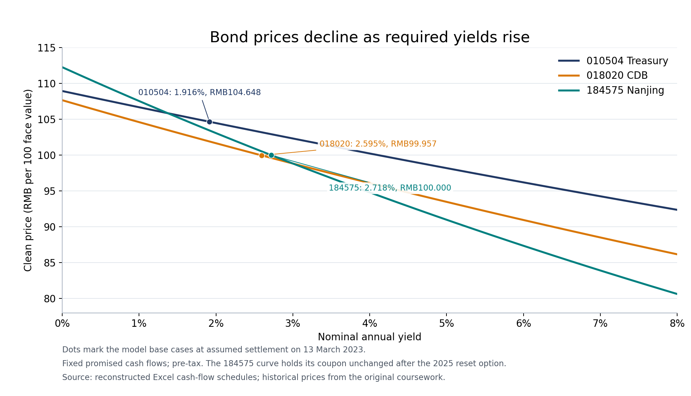

# China Fixed Income Analysis

*Jiarong Xu | Bond valuation, fund screening and credit-event analysis*

## Project Background

This project develops an undergraduate asset-pricing assignment into a fixed-income research study. It examines three related questions: how bond prices translate into yields, how a conservative investor can compare bond funds, and how contractual repayment rights interact with credit risk. The original research used Chinese bond-market observations from March 2023. This portfolio edition reconstructs the calculations and expands the interpretation of the available material.

The coursework was a group submission. This portfolio edition presents the reconstructed model and revised analysis prepared by Jiarong Xu. It excludes the original cover page, student identifiers and third-party paper PDFs.

[Open the Excel model](../models/China_Fixed_Income_Model.xlsx).

## 1. Bond Prices and Yield to Maturity

### 1.1 Historical inputs and conventions

The working draft *Yield to Maturity and Selection of Debt Funds (2)* preserves prices to three decimals. These are used in preference to the rounded prices in the final essay. The observation date is 13 March 2023. Settlement is assumed to occur on the same date. Prices are expressed in RMB per RMB100 face value and treated as clean prices in the base calculation.

| Bond | Code | Quoted price | Annual coupon | Payments per year | Contractual maturity |
| --- | --- | ---: | ---: | ---: | --- |
| 05 Treasury (4) | 010504 | 104.648 | 4.11% | 2 | 15 May 2025 |
| CDB 2302 | 018020 | 99.957 | 2.58% | 1 | 1 March 2026 |
| 22 Nanjing Anju | 184575 | 100.000 | 2.72% | 1 | 14 September 2027 |

The price and quoted-yield observations are attributed to the original 2023 coursework. The model's clean-price treatment is an explicit assumption about those observations, not a recovered market-data field. Each bond tab includes a **Clean / Full** price-basis selector to show the effect of the alternative interpretation.

Cash flows follow the scheduled contractual coupon dates without business-day adjustments. Returns are before taxes and transaction costs. The cash-flow schedules are specific to these bonds. A settlement-date change is supported only within the stated current coupon period; moving beyond it requires updating the schedule and previous-coupon date.

### 1.2 Accrued interest and full price

The coupon rate determines the contractual interest payment. YTM is instead the annualized discount rate implied by the price paid and the remaining payments. A clean price excludes accrued interest; the full (dirty) price includes it and is the cash amount used in the valuation equation. All prices and payments below use the same RMB100 face-value basis.

A buyer between coupon dates pays for the interest accrued since the previous coupon. Let F be face value, c the annual coupon rate, f the number of coupons per year, t elapsed days since the previous coupon, and TS the actual days in the current coupon period.

$$
AI=\frac{Fc}{f}\frac{t}{TS}
$$

$$
P_{full}=P_{clean}+AI
$$

For 010504, the current coupon period runs from 15 November 2022 to 15 May 2023. There are 181 days in that period and 118 accrued days at the assumed settlement date. Its semiannual coupon is:

$$
C=\frac{100\times0.0411}{2}=2.055
$$

$$
AI=2.055\times\frac{118}{181}=1.339724
$$

$$
P_{full}=104.648+1.339724=105.987724
$$

### 1.3 Discounting the scheduled payments

YTM is the discount rate that equates the full settlement price to the present value of the promised cash flows. Define the fraction of the current coupon period remaining as:

$$
\alpha=\frac{d}{TS}
$$

Here d is the number of days from settlement to the next coupon date. With n remaining coupon payments, the model solves for nominal annual yield y:

The summation sign $\sum$ adds the present values of all remaining coupons. The final term adds principal once at maturity. Dividing annual yield $y$ by payment frequency $f$ gives the rate per coupon period; the exponent measures time in coupon periods. Thus $\alpha+i-1$ allows the first payment to be less than a full period away. Rates are decimals in calculations, so 4.11% is 0.0411.

$$
P_{full}=\sum_{i=1}^{n}\frac{Fc/f}{(1+y/f)^{\alpha+i-1}}+
\frac{F}{(1+y/f)^{\alpha+n-1}}
$$

This coupon-period method follows the structure of formula (6) in the supplied 2007 PBOC calculation attachment, printed p.4. It is a stated modelling convention, rather than a claim to reproduce every exchange quoting or settlement convention. The formula applies to the multi-coupon schedules studied here. The attachment also contains different formulas for other payment structures.

For example, 010504 has five semiannual payments remaining and $\alpha=63/181$. Its equation can be written without summation notation:

$$
\begin{aligned}
105.987724={}&\frac{2.055}{(1+y/2)^{63/181}}
+\frac{2.055}{(1+y/2)^{63/181+1}}\\
&+\frac{2.055}{(1+y/2)^{63/181+2}}
+\frac{2.055}{(1+y/2)^{63/181+3}}\\
&+\frac{102.055}{(1+y/2)^{63/181+4}}
\end{aligned}
$$

The last payment includes the RMB100 principal. Solving for $y$ gives approximately 0.0191593, or **1.916%** nominal annual YTM. This is the yield that reproduces the assumed full price, not a separate forecast of the bond's return.

The workbook solves the equation by bisection between nominal yields of -10% and 100%. Each step compares the discounted cash flows with the full price and narrows the yield interval. The calculation is visible below each bond schedule and uses ordinary Excel formulas, without macros or external workbook links. Prices whose yields fall outside the bracket return `n.a.`.

Effective annual yield incorporates the annual effect of coupon-frequency compounding:

$$
y_{effective}=\left(1+\frac{y}{f}\right)^f-1
$$

| Code | Accrued interest | Full price | Reconstructed nominal YTM | Effective annual yield | Quoted yield in coursework |
| --- | ---: | ---: | ---: | ---: | ---: |
| 010504 | 1.339724 | 105.987724 | 1.916% | 1.925% | 1.92% |
| 018020 | 0.084590 | 100.041590 | 2.595% | 2.595% | 2.59% |
| 184575 | 1.341370 | 101.341370 | 2.718% | 2.718% | 2.72% |

The reconstructed yields are close to the quoted observations. Small differences can reflect price precision, settlement timing, day-count treatment or quote conventions. Agreement alone does not identify which convention the original platform used. The data do not support a general conclusion that Chinese quoted YTM excludes compounding.

For a premium bond such as 010504, the annual coupon rate exceeds YTM because the investor pays above the principal repaid at maturity. Its current yield, defined below, measures coupon income only and omits the price-to-redemption effect:

$$
y_{current}=\frac{Fc}{P_{clean}}
$$

### 1.4 Yield, realized return and the put option

Calculating YTM does not require assuming that actual reinvestment has already occurred. However, interpreting it as an achieved compound return to maturity requires suitable reinvestment of interim coupons, timely promised payments and holding to the relevant horizon. A change in reinvestment rates, early sale or default can produce a different realized return. Caks (1977), particularly pp.103–104, provides the conceptual basis for distinguishing YTM from realized performance and from a full term structure of spot rates.

For 184575, the bond includes a third-year investor put and a coupon-reset provision. The maturity scenario holds the 2.72% coupon constant after the reset date, an assumption rather than a forecast of the later decision. The alternative put scenario assumes valid exercise and receipt of par plus the scheduled coupon on the contractual put date, 14 September 2025. Its reconstructed yield to put is **2.716%**. It is a separate contractual scenario, not a guaranteed return or a complete option-adjusted valuation.

Yield to put uses the same discounting equation, but stops cash flows at the put date and replaces maturity principal with the assumed put payment. Here, three annual payments remain to the put date, $f=1$ and $\alpha=185/365$:

$$
101.341370=\frac{2.72}{(1+y_{put})^{185/365}}+\frac{2.72}{(1+y_{put})^{185/365+1}}+\frac{102.72}{(1+y_{put})^{185/365+2}}
$$

Solving gives $y_{put}\approx2.716\%$. The put-date scenario replaces the maturity scenario; its payments are not added to the maturity cash flows.

The workbook also reprices the maturity cash flows at yields 100 basis points above and below the solved YTM. Higher required yields reduce the present value of the fixed promised cash flows. For the option-bearing bond, this is a fixed-cash-flow sensitivity rather than an estimate of option-adjusted duration.

### 1.5 Price–Yield Curves

The chart prices the same promised cash flows across nominal annual yields from 0% to 8%. Each dot identifies a model base-case yield and clean price. The Excel **Price_Yield** worksheet contains an editable chart and formula-linked price grid. The report image is a static export of the stated assumptions.

The curves slope downward because increasing the discount rate reduces the present value of the fixed cash flows. For example, 010504 has a base clean price of RMB104.648; repricing its cash flows at yields 100 basis points below and above its base YTM gives approximately RMB106.859 and RMB102.494 respectively. These are interest-rate scenarios, not forecast market prices.

Different remaining payment horizons and coupon patterns produce different sensitivities. The 184575 curve is a constant-coupon maturity scenario. It does not measure the value of its put or coupon-reset option, and none of the curves incorporate default losses or liquidity changes.

## 2. Bond-Fund Screening

### 2.1 Investor objective and sample

The screening objective is a conservative fixed-income allocation with limited equity exposure. That is an investor-specific objective, not a claim that every bond investor has the same risk preference. The original coursework considered the following sample:

| Code | Name as recorded in the coursework |
| --- | --- |
| 003545 | Dongxing Xingli Bond A |
| 010440 | Nuode Anhong Pure Bond A |
| 009111 | Boyuan Shuangzhai Zengli Bond A |
| 217022 | Zhaoshang Industrial Bond A |
| 210014 | Jinying Yuanfeng Bond A |

These names identify the historical research sample. Investment eligibility and risk exposure must be established from fund contracts and dated holdings rather than inferred solely from an English name or a broad fund label.

### 2.2 Comparison framework

| Dimension | Information to compare | Analytical use |
| --- | --- | --- |
| Mandate | Equity and convertible-bond eligibility, credit limits, investment universe | Determine fit with the conservative objective |
| Interest-rate exposure | Duration, maturity profile, leverage | Assess sensitivity to rate changes |
| Credit and liquidity | Issuer concentration, ratings, lower-liquidity holdings, redemption terms | Assess loss and liquidity risk |
| Performance | Total return, volatility, maximum drawdown and risk-adjusted returns over the same dates | Compare outcomes on a consistent basis |
| Fees | Management, custody, subscription and holding-period redemption charges | Compare investor costs |
| Management | Manager tenure, mandate changes, process and resources | Assess the continuity of the observed record |
| Scale and flows | Assets under management, investor concentration and subscriptions/redemptions | Consider capacity and redemption pressures |

For periodic total returns, a sample Sharpe ratio is:

$$
S=\frac{\overline{r_p-r_f}}{s(r_p-r_f)}\sqrt{k}
$$

Here $r_p$ is the fund's periodic total return, $r_f$ is the risk-free return for the same period, the overbar denotes the sample mean, and $s$ denotes sample standard deviation. The ratio measures average excess return per unit of variability in excess returns. $k$ is the number of observations per year, for example 12 for monthly returns. Multiplying by $\sqrt{k}$ is a conventional annualization under an assumption of uncorrelated periodic excess returns; serial correlation can make that conversion misleading. Frequency, the risk-free series, annualization and the measurement window must be identical across funds.

One common Calmar-ratio convention is:

$$
Calmar=\frac{R_{annualized}}{|MDD|}
$$

$$
MDD=\min_t\left(\frac{V_t}{\max_{u\leq t}V_u}-1\right)
$$

V is a total-return wealth index including distributions. Other providers use variants, so the definition must accompany a comparison. Both Sharpe and Calmar are ratios and ordinarily are displayed without percentage signs. Zero volatility or zero drawdown requires a separate treatment rather than division by zero.

For an observation window spanning $Y>0$ years, the annualized geometric total return used in this convention is:

$$
R_{annualized}=\left(\frac{V_{end}}{V_{start}}\right)^{1/Y}-1
$$

Maximum drawdown (MDD) is the largest percentage fall from an earlier peak within that same window. The formula records it as a negative number; Calmar divides annualized return by its positive magnitude. Sharpe therefore summarizes variability of excess returns, while Calmar focuses on the worst historical peak-to-trough loss. Neither formula creates a fund ranking here because the required common return series is unavailable.

### 2.3 Interpretation of the historical preference

The original essay preferred Nuode Anhong Pure Bond A within its sample. The portfolio analysis retains this as the coursework's historical preference, not a new quantitative ranking. The preserved materials do not establish a common dated return series, risk-free input or calculation method for the reported ratio figures. Those figures therefore are not used to present a numerical league table.

A defensible selection starts with mandate fit, then compares dated holdings, consistent risk measures and fees. Larger assets under management alone do not demonstrate why a fund underperformed. Similarly, excluding convertible or equity exposure may fit this investor's objective, but does not imply that those exposures are inferior for other investors. A separate equity fund and a bond fund also need not replicate an actively managed mixed-exposure fund's holdings or behaviour.

## 3. Sino-Ocean Capital Credit Case

### 3.1 Observed price divergence

The original essay attributed the following price pairs to East Money on 17 March 2023. They are used as the coursework's historical observations without assuming identical trade times or liquidity.

$$
R_{price}=\frac{P_1}{P_0}-1
$$

Here $P_0$ and $P_1$ are the earlier and later prices. For example, $67.999/33.000-1=1.060576$, displayed as **106.06%**. The decimal return is multiplied by 100 only when it is displayed as a percentage.

| Bond | Code | Earlier price | Later price | Price change |
| --- | --- | ---: | ---: | ---: |
| 20 Yuanzi 01 | 175093 | 70.495 | 65.003 | -7.79% |
| 21 Yuanzi 01 | 175670 | 33.000 | 67.999 | +106.06% |

These calculations are price returns on the supplied pairs. They exclude coupon income, transaction costs and any difference in quote basis. They do not establish that these were the market's largest gain and loss. A return exceeding 100% is arithmetically possible when a deeply discounted bond more than doubles from a low starting price.

### 3.2 Contractual and credit context

The issuer is **Sino-Ocean Capital Limited**. A relationship with Sino-Ocean Group does not make the listed parent the contractual issuer of these bonds. Issuer obligations, explicit guarantees and potential shareholder support must be considered separately.

| Historical event or term | Implication |
| --- | --- |
| 20 Yuanzi 01: 2022 holders' meeting changed the payment arrangement, with payment set for 9 September 2023 regardless of second-year put exercise | The initial put terms alone do not describe the subsequent repayment arrangement |
| 21 Yuanzi 01: contractual put date of 10 June 2023 and maturity of 10 June 2024 | The potential put horizon differs from contractual maturity |
| Both bonds have issuer-specific repayment risk | A contractual right to par payment does not remove the risk of non-payment |

These historical terms are described in the issuer's 2022 bond annual report, printed pp.14–16, published in May 2023. That later report is used retrospectively to describe the contracts and the 2022 event; it is not treated as information published before 17 March 2023. The 2020 offering document supplies additional original contract context, but should not override subsequent amendments.

### 3.3 Event Timeline

The timeline distinguishes the events being studied from the later disclosures used to document them. Notice dates below are publication dates on the SSE disclosure site. Contractual dates are identified separately from holiday-adjusted payment dates.

| Date | Event or publication | Analytical relevance | Reference |
| --- | --- | --- | --- |
| 9 September 2020 | Interest begins accruing on 20 Yuanzi 01; contractual maturity is 9 September 2023 | Establishes its original repayment horizon | 2022 bond annual report, printed p.14 |
| 10 June 2021 | Interest begins accruing on 21 Yuanzi 01; contractual put date is 10 June 2023 and maturity is 10 June 2024 | The put and maturity horizons differ | 2022 bond annual report, printed pp.14–15 |
| 5 September 2022 | Holders' meeting changes the 20 Yuanzi 01 payment arrangement to 9 September 2023 regardless of second-year put exercise | The subsequent repayment terms differ from the original put provision | Event described retrospectively in the 2022 bond annual report, printed pp.15–16, published May 2023 |
| 17 March 2023 | The coursework records contrasting price changes for the two bonds | Observation selected for analysis, not a demonstrated causal mechanism | Original coursework, section 3 |
| 9 May 2023 — subsequent publication | The issuer publishes the 21 Yuanzi 01 put implementation notice: registration on 15–17 May and payment scheduled for 12 June 2023 | The notice schedules payment after the contractual 10 June date because it falls on a non-trading day | [Put implementation notice](https://static.sse.com.cn/disclosure/bond/announcement/company/c/new/2023-05-09/175670_20230509_R3EX.pdf), pp.1–2 |
| 7 June 2023 — subsequent publication | The issuer reports RMB455 million in registered put claims and warns that the related payment funding has not been secured | Illustrates the distinction between a put claim and certainty of payment | [Put result notice](https://static.sse.com.cn/disclosure/bond/announcement/company/c/new/2023-06-07/175670_20230607_UA2Q.pdf), pp.1–2 |

The May and June publications occurred after the March price observations. They provide subsequent contract and credit context; they are not presented as the information that caused the 17 March price changes. The June notice reports registered claims and payment uncertainty, not completed cash repayment.

### 3.4 Possible Explanations and Evidence Needed

| Possible explanation | Mechanism | Evidence needed to distinguish it |
| --- | --- | --- |
| Different repayment expectations | Investors may assign different values to near-term put claims and later maturity claims | Notices available before the observed trades, amended terms, registration eligibility and dated financing information |
| Liquidity and transaction effects | A small number of trades can generate a large price change in a thin market | Trade timestamps, sizes, turnover, bid–ask spreads and the sequence of transactions |
| A stale or inconsistent comparison price | A low or old reference price can magnify the reported percentage change | The prior actual trade, quote convention and comparable clean-price observations |
| Changed issuer credit expectations | New information about liquidity, asset sales or refinancing can alter expected repayment | Contemporaneous issuer announcements, rating actions and evidence of available cash or financing |
| Competition for issuer cash | Repayment of one claim could affect resources available for other claims | A dated debt-maturity schedule, cash resources, legal claim priorities and documented funding plans |

These explanations can coexist. The two price pairs support descriptive comparison, but cannot identify which mechanism dominated. The analytical conclusion therefore remains conditional: different contractual horizons and credit expectations are relevant to investigate, while the cause of the one-day divergence is not isolated by the preserved observations.

### 3.5 Explaining the difference without overstating causation

Different repayment horizons and expectations about a put payment could contribute to divergent prices. Trading liquidity, stale preceding prices, transaction size and revised credit expectations could also matter. The supplied price pairs do not identify the marginal investor or isolate a single cause.

In particular, an approaching put-registration announcement does not mechanically require a price increase. Investors must consider eligibility, registration, amendments and the issuer's cash resources. An argument that repayment of one bond diverts cash from another requires dated cash balances, competing maturities and documented financing arrangements. Those effects cannot be established from two price changes alone.

The case illustrates the distinction between contractual cash flows and expected recoveries. A high promised YTM on a distressed bond can coexist with a low expected realized return when repayment is uncertain.

## Conclusions

The bond examples show how coupon frequency, accrued interest and consistent timing connect prices to yields. The fund exercise shows why a selection framework needs comparable dated inputs before it can produce a numerical ranking. The Sino-Ocean Capital case shows why repayment rights and issuer creditworthiness must be analysed together.

The reconstructed workbook provides transparent coupon schedules, editable price assumptions, YTM and yield-to-put calculations, and fixed-cash-flow price sensitivities. It is a historical research exercise rather than a current investment recommendation.

## Input References

| Input or method | Reference |
| --- | --- |
| Three-decimal prices and quoted yields, 13 March 2023 | Original working draft, *Yield to Maturity and Selection of Debt Funds (2)*, individual bond entries |
| 010504 coupon frequency and maturity | SSE Statistical Yearbook 2012, government-bond terms table; MOF issue notice for 2005 book-entry Treasury bond, fourth issue |
| 018020 coupon and payment dates | SSE listing notice dated 28 February 2023, p.1 |
| 184575 coupon, maturity and option terms | Nanjing Anju Construction Group 2022 bond annual report, printed pp.23 and 25; 2025 interest-payment notice, pp.1–2, for retrospective description of reset terms |
| Accrued interest and coupon-period discounting | Supplied PBOC 2007 formula adjustment attachment, printed pp.3–4, formulas (1) and (6) |
| YTM versus realized return | Caks (1977), pp.103–104 |
| Historical fund sample and preference | Original final coursework, section 2, and supplied fund-selection working paper |
| Credit-case price pairs, 17 March 2023 | Original final coursework, section 3, and separate credit-case working paper, attributed there to East Money |
| Sino-Ocean bond terms and 2022 payment change | Sino-Ocean Capital 2022 bond annual report, printed pp.14–16; original 2020 offering document |
| May and June 2023 put registration, scheduled payment and funding warning | 21 Yuanzi 01 issuer notices published 9 May and 7 June 2023, pp.1–2 |
| Settlement, price interpretation and fixed post-reset coupon | Analyst assumptions described in the report and model |

## References

- Shanghai Stock Exchange. [Statistical Yearbook 2012](https://www.sse.com.cn/aboutus/publication/yearly/documents/c/10061082/files/a21d89f75cc64fb5bbcabeb3fdc84ee9.pdf), government-bond terms table, code 010504.
- Ministry of Finance. [Issue notice for the 2005 book-entry Treasury bond, fourth issue](https://www.mof.gov.cn/zhengwuxinxi/caizhengxinwen/200805/t20080519_20782.htm).
- Shanghai Stock Exchange. [Listing notice for CDB 2302](https://static.sse.com.cn/disclosure/bond/announcement/common/c/new/2023-02-28/018020_20230228_F8L7.pdf), 28 February 2023.
- Nanjing Anju Construction Group. [2022 Bond Annual Report](https://static.sse.com.cn/disclosure/bond/announcement/company/c/new/2023-04-26/143381_20230426_KQKX.pdf), published April 2023.
- Nanjing Anju Construction Group. [2025 Interest-Payment Notice, code 184575](https://static.sse.com.cn/disclosure/bond/announcement/corporate/c/new/2025-09-06/184575_20250906_ZBYV.pdf). Used for retrospective contract description, not as a March 2023 observation.
- People's Bank of China. *Notice on Improving the Standards for Calculating Bond Yield to Maturity in the National Interbank Bond Market*, Yinfa [2007] No.200. Supplied attachment: *Comparison of Adjusted Bond Yield-to-Maturity Calculation Standards*, printed pp.3–4. Cited as historical methodology.
- Caks, J. (1977). “The Coupon Effect on Yield to Maturity.” *The Journal of Finance*, 32(1), 103–115. [JSTOR record](https://www.jstor.org/stable/2326906).
- Sharpe, W. F. (1994). [The Sharpe Ratio](https://web.stanford.edu/~wfsharpe/art/sr/SR.htm). *The Journal of Portfolio Management*, Fall 1994. Definitions of differential-return mean and variability, and assumptions behind time scaling.
- Sino-Ocean Capital Limited. [2020 Offering Document](https://static.sse.com.cn/disclosure/bond/announcement/company/c/2020-09-04/3966102353075930292755427.pdf).
- Sino-Ocean Capital Limited. [2022 Bond Annual Report](https://static.sse.com.cn/disclosure/bond/announcement/company/c/new/2023-05-31/175670_20230531_A06X.pdf), published May 2023.

- Sino-Ocean Capital Limited. [21 Yuanzi 01 Put Implementation Notice](https://static.sse.com.cn/disclosure/bond/announcement/company/c/new/2023-05-09/175670_20230509_R3EX.pdf), published 9 May 2023, pp.1–2.
- Sino-Ocean Capital Limited. [21 Yuanzi 01 Put Result Notice](https://static.sse.com.cn/disclosure/bond/announcement/company/c/new/2023-06-07/175670_20230607_UA2Q.pdf), published 7 June 2023, pp.1–2.
